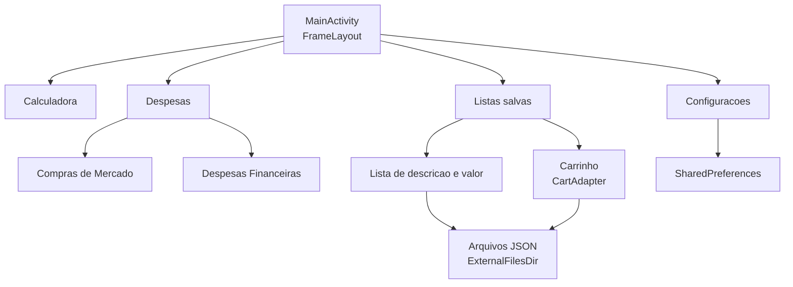

# Fluxo das quatro abas

## Etapa 1. Navegação

A `MainActivity` monta todas as páginas no mesmo `FrameLayout` e troca a
visibilidade conforme a aba escolhida. Só uma página fica visível por vez.

## Etapa 2. Calculadora

A expressão é montada na tela e avaliada em memória. O histórico fica
disponível para a consulta.

## Etapa 3. Despesas

Compras de mercado e despesas financeiras têm arquivos separados. Cada
arquivo guarda uma lista de lançamentos com data, descrição, valor e
categoria.

## Etapa 4. Listas salvas

Uma lista nova nasce da tela de entrada, com descrição, valor e categoria. O
carrinho acumula os itens e o `CartAdapter` desenha a lista.

## Etapa 5. Persistência

As listas e os lançamentos vão para arquivos JSON na pasta externa do
aplicativo. As preferências ficam no `SharedPreferences`.
